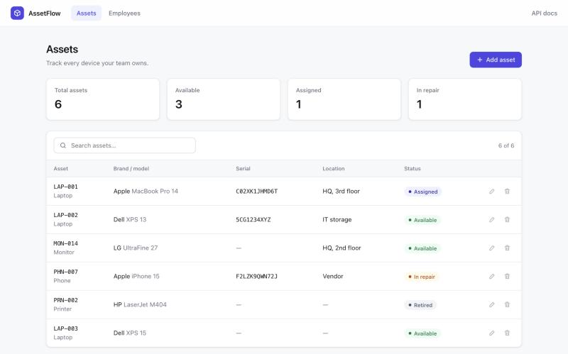
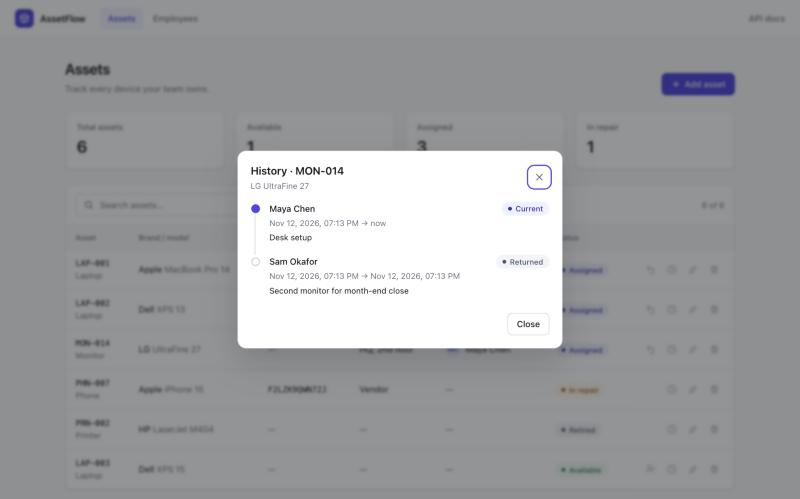
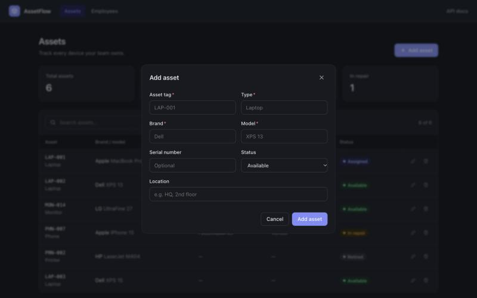

# AssetFlow

[](https://github.com/AD-coderr/AssetFlow/actions/workflows/tests.yml)


[](LICENSE)

AssetFlow is a lightweight **IT asset management** app: keep track of laptops, monitors, phones and other devices, and the employees who use them.
It's a FastAPI + SQLAlchemy backend with a clean, dependency-free web UI.





<details>
<summary>Dark mode &amp; add-asset dialog</summary>


</details>

## Features

- **Assets** — create, edit, delete and search devices with tag, type, brand, model, serial number, location and status (Available, Assigned, In repair, Retired)
- **Employees** — manage the people assets get assigned to
- **Assignments** — check an asset out to an employee and back in, with a full history per asset and per employee
- **Business rules** — only available assets can be assigned; an assigned asset must be returned before it can be retired, deleted or re-assigned; an employee holding assets can't be deleted
- **Dashboard stats** — totals and status counts at a glance
- **AI search (optional)** — ask in plain language, e.g. *“which laptops in Berlin are free?”*, and get the matching assets ([how it works](#ai-search))
- **Validation** — required fields checked in the UI and API; duplicate asset tags, serial numbers or emails return `409 Conflict`
- **Light & dark mode**, responsive down to phone widths
- **Interactive API docs** via Swagger UI at `/docs`

## Tech stack

| Layer    | Tools |
|----------|-------|
| Backend  | Python, FastAPI, SQLAlchemy 2, Pydantic 2 |
| Database | SQLite (configurable via `ASSETFLOW_DATABASE_URL`) |
| Frontend | Plain HTML, CSS and JavaScript (no build step) |
| AI       | Any OpenAI-compatible chat API (optional), called with the standard library |
| Testing  | pytest, GitHub Actions |

## Getting started

```bash
git clone https://github.com/AD-coderr/AssetFlow.git
cd AssetFlow/backend
python3 -m venv venv
source venv/bin/activate
pip install -r requirements-dev.txt
uvicorn app.main:app --reload
```

Then open:

- **Web UI:** http://127.0.0.1:8000/ui/
- **API docs:** http://127.0.0.1:8000/docs

The SQLite database is created automatically at `backend/assetflow.db`.

## API

| Resource  | Endpoints |
|-----------|-----------|
| Assets    | `GET/POST /assets`, `GET/PUT/DELETE /assets/{id}` |
| Employees | `GET/POST /employees`, `GET/PUT/DELETE /employees/{id}` |
| Assignments | `POST /assets/{id}/assign`, `POST /assets/{id}/return`, `GET /assets/{id}/assignments`, `GET /employees/{id}/assignments`, `GET /assignments?active=true` |
| Users     | `GET /users` (read-only; never returns password hashes) |
| AI        | `GET /ai/status`, `POST /ai/search` |

## AI search

Type a question into the **Ask AI** bar on the Assets page and AssetFlow narrows the table to the matching devices, showing how it understood the question:

> *which laptops in Berlin are free?* → `Status: Available` · `Type: Laptop` · `Location: Berlin`

How it works:

1. `POST /ai/search` sends the question to a language model, together with the asset types, brands, locations and departments that exist in the database.
2. The model replies with a small JSON filter (status, type, brand, model, location, current holder, department, free text).
3. The reply is validated with Pydantic, and the API builds the database query itself with SQLAlchemy.

The model never writes SQL and has no access to the database, so a manipulated question can at worst produce a wrong filter. Unknown keys are dropped and invalid values are rejected with `502`.

AI search is **off by default** and the app works fully without it. To turn it on, point AssetFlow at any OpenAI-compatible chat API before starting the server:

```bash
export ASSETFLOW_LLM_BASE_URL="https://api.openai.com/v1"   # or your provider's OpenAI-compatible URL
export ASSETFLOW_LLM_MODEL="<model name from your provider>"
export ASSETFLOW_LLM_API_KEY="<your key>"                     # not needed for a local server
```

For a free, fully local setup, run [Ollama](https://ollama.com) and use `ASSETFLOW_LLM_BASE_URL="http://localhost:11434/v1"` with the name of a model you have pulled. See [`.env.example`](.env.example) for all settings.

Besides the question itself, only the lists of existing asset types, brands, locations and departments are sent to the provider you configure.

## Project structure

```
AssetFlow/
├── backend/
│   ├── app/
│   │   ├── ai/         # LLM client for AI search
│   │   ├── database/   # engine, session, get_db dependency
│   │   ├── models/     # SQLAlchemy models
│   │   ├── routes/     # API endpoints
│   │   ├── schemas/    # Pydantic request/response models
│   │   └── main.py     # app entry point, serves the UI at /ui
│   └── tests/
└── frontend/           # web UI (index.html, styles.css, app.js)
```

## Running tests

```bash
cd backend
pytest
```

## Roadmap

- [x] Assign assets to employees (check-out / check-in history)
- [x] AI search in plain language
- [ ] Authentication and roles
- [ ] CSV import / export
- [ ] Docker setup

## License

[MIT](LICENSE)
