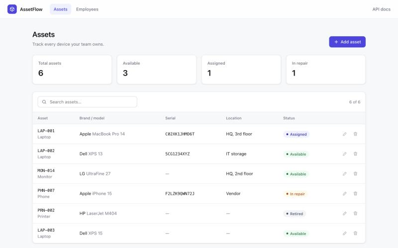
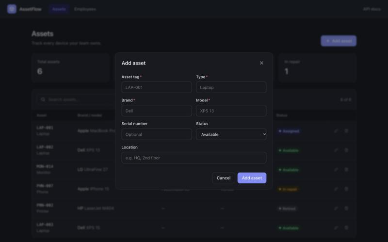

# AssetFlow

[](https://github.com/AD-coderr/AssetFlow/actions/workflows/tests.yml)


[](LICENSE)

AssetFlow is a lightweight **IT asset management** app: keep track of laptops, monitors, phones and other devices, and the employees who use them.
It's a FastAPI + SQLAlchemy backend with a clean, dependency-free web UI.



<details>
<summary>Dark mode &amp; add-asset dialog</summary>


</details>

## Features

- **Assets** — create, edit, delete and search devices with tag, type, brand, model, serial number, location and status (Available, Assigned, In repair, Retired)
- **Employees** — manage the people assets get assigned to
- **Dashboard stats** — totals and status counts at a glance
- **Validation** — required fields checked in the UI and API; duplicate asset tags, serial numbers or emails return `409 Conflict`
- **Light & dark mode**, responsive down to phone widths
- **Interactive API docs** via Swagger UI at `/docs`

## Tech stack

| Layer    | Tools |
|----------|-------|
| Backend  | Python, FastAPI, SQLAlchemy 2, Pydantic 2 |
| Database | SQLite (configurable via `ASSETFLOW_DATABASE_URL`) |
| Frontend | Plain HTML, CSS and JavaScript (no build step) |
| Testing  | pytest, GitHub Actions |

## Getting started

```bash
git clone https://github.com/AD-coderr/AssetFlow.git
cd AssetFlow/backend
python3 -m venv venv
source venv/bin/activate
pip install -r requirements-dev.txt
uvicorn app.main:app --reload
```

Then open:

- **Web UI:** http://127.0.0.1:8000/ui/
- **API docs:** http://127.0.0.1:8000/docs

The SQLite database is created automatically at `backend/assetflow.db`.

## API

| Resource  | Endpoints |
|-----------|-----------|
| Assets    | `GET/POST /assets`, `GET/PUT/DELETE /assets/{id}` |
| Employees | `GET/POST /employees`, `GET/PUT/DELETE /employees/{id}` |
| Users     | `GET /users` (read-only; never returns password hashes) |

## Project structure

```
AssetFlow/
├── backend/
│   ├── app/
│   │   ├── database/   # engine, session, get_db dependency
│   │   ├── models/     # SQLAlchemy models
│   │   ├── routes/     # API endpoints
│   │   ├── schemas/    # Pydantic request/response models
│   │   └── main.py     # app entry point, serves the UI at /ui
│   └── tests/
└── frontend/           # web UI (index.html, styles.css, app.js)
```

## Running tests

```bash
cd backend
pytest
```

## Roadmap

- [ ] Assign assets to employees (check-out / check-in history)
- [ ] Authentication and roles
- [ ] CSV import / export
- [ ] Docker setup

## License

[MIT](LICENSE)
